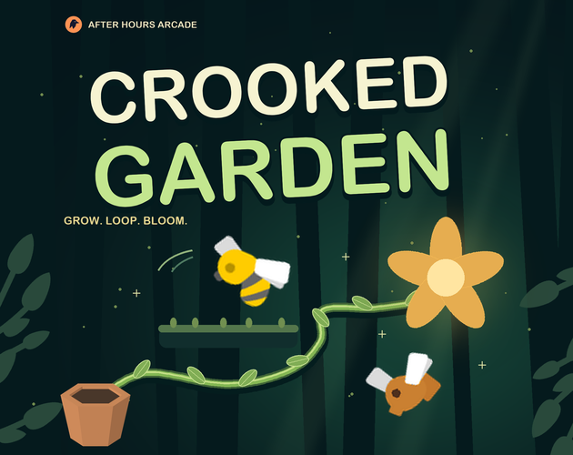

# Crooked Garden

Grow a vine, catch bugs in loops, and reach every flower before your water runs out.

[](https://ravendeath.itch.io/crooked-garden)



## Controls

- **Floating joystick:** touch or click anywhere in the garden, then drag in the direction you want the vine to grow. Release or centre it to stop growing. The joystick disappears on release. Tap **Burst** with your other thumb while steering.
- **Keyboard alternative:** arrows aim; hold **G** to grow.
- **Shift / Burst** protects against bugs, not walls.
- **Space / Esc** pauses · **Z** rewinds · **R** retries the garden.

You have **3 rewinds for the entire three-garden run**. Each costs **100 points**, with a “−100 PTS” popup and a remaining-use counter. Retrying a garden restores neither rewinds nor deducted points; only starting a new run resets the allowance.

Letting go stops the vine—not the bugs. Sound is **on by default**; music starts when you start playing. Tap **♫** to mute or unmute.

The joystick is translucent so you can see the garden beneath it. On desktop, a small cream cursor marks where you'll click; the joystick replaces it while dragging. Pause, release, touch cancellation and resizing clear the stick input.

## Main menu

**How to Play** and **Leaderboard** sit side by side beneath **Let It Grow**. The buttons have a soft left-to-right glow; Let It Grow breathes between 0.9× and 1.05×, with a centred label and no play icon. Reduced-motion settings disable these animations.

## Browser build

Upload [`buildDirectories/crooked-garden.zip`](buildDirectories/crooked-garden.zip) to itch.io as an HTML game. To rebuild locally, run `npm install` then `npm run package`. See [development notes](DEVELOPMENT.md) for testing and embed settings.

## Wavedash

On Wavedash, completed three-garden runs automatically submit to the native **Garden Masters** leaderboard. Four achievements reward your first flower (**First Bloom**), first catch (**Bug Gardener**), a multi-catch (**Double Trouble**), and clearing all three gardens (**The Garden Lives**). The achievement definitions have been imported; the uploaded Wavedash build still needs live gameplay verification before publishing. [Setup and verification checklist](docs/WAVEDASH.md).

## Global leaderboard

**Leaderboard → All platforms** shows a shared Top 10 on itch.io, Newgrounds and Wavedash. **Global Best** on the results screen is read from Supabase's highest submitted score—not a browser-local record. Complete three gardens, choose a public name and optionally **Share global score**. Reading scores creates no account; sharing creates a guest identity saved per browser/site, with no email required. Keep that identity across repeat runs: every submitted run is stored separately, while the public board keeps one personal best per identity. Retrying the same submission never duplicates it. Wavedash players can also switch to the native Wavedash tab.

The Supabase database migrations and score-submission function are **deployed**. Public reads, rejection of unauthorized writes, and repeat-run history/idempotency have been checked against the live database; database regression checks roll back their test records. Full in-game submission still needs verification inside each platform's frame. The backend applies name/score validation and a five-second per-guest submission limit—not replay-based anti-cheat. Gameplay remains playable without a network connection, and an unavailable global record is shown as “—” rather than a local score. [Deployment, privacy and free-tier notes](docs/SUPABASE.md).

Only the Supabase publishable key is included in the browser build. Database passwords, service-role keys and Wavedash developer tokens are not bundled.

## Checks

```sh
npm test
npm run build
env -u NODE_OPTIONS npm run test:browser
env -u NODE_OPTIONS npm run test:joystick
env -u NODE_OPTIONS npm run test:wavedash
```

Browser tests cover gameplay, responsive layouts, floating controls, and mocked Wavedash/Supabase integration. Mock tests do not submit scores to the live services.

An **After Hours Arcade** game by [TahmidRaven](https://tahmidraven.com). Built with LittleJS for LittleJS Jam 3, theme **ZIGZAG**.

[Credits](CREDITS.md) · [Development & build instructions](DEVELOPMENT.md) · [Screenshots](screenshots/)
