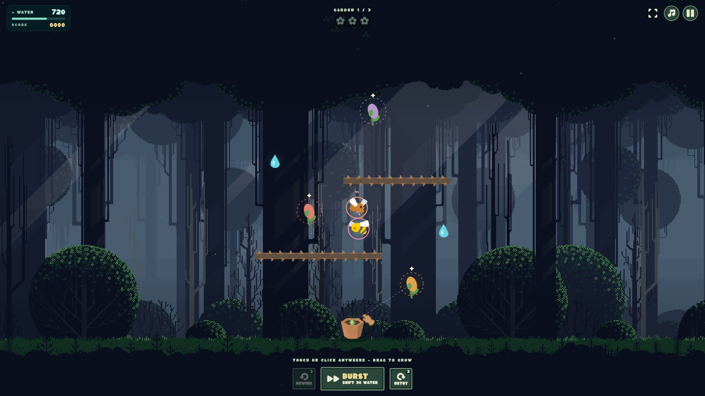

# Crooked Garden

Grow a vine, catch bugs in loops, and reach every flower before your water runs out.

[](https://ravendeath.itch.io/crooked-garden)
[](https://wavedash.com/games/crooked-garden)



[Current screenshots](screenshots_updated/) · [Earlier V4 gameplay video](screenshots/crooked-garden-gameplay-v4-1920x1080.mp4) · [16:9 Wavedash cover](screenshots/cover-v4-wavedash-1920x1080.png)

## Controls

- **Floating joystick:** touch or click anywhere in the garden, then drag in the direction you want the vine to grow. Release or centre it to stop growing. The joystick disappears on release. Tap **Burst** with your other thumb while steering.
- **Keyboard alternative:** arrows aim; hold **G** to grow.
- **Shift / Burst** protects against bugs, not walls.
- **Space / Esc** pauses · **Z** rewinds · **R** retries the garden.

You have **3 rewinds for the entire three-garden run**. Each costs **100 points**, with a “−100 PTS” popup and a remaining-use counter. Retrying a garden restores neither rewinds nor deducted points; only starting a new run resets the allowance.

You also have **3 retries for the entire run**, costing **300 points each**, separate from rewinds. The Retry button, pause-menu retry, **R**, and retrying after a loss all use that same allowance. New gardens refill neither allowance, and all penalties carry through the run. Once retries are spent, keep playing the current attempt or use a remaining rewind; after losing, start a new run.

Letting go stops the vine—not the bugs. Sound is **on by default**; music starts when you start playing. Tap the music icon to mute or unmute.

The joystick is translucent so you can see the garden beneath it. On desktop, a small cream cursor marks where you'll click; the joystick replaces it while dragging. Pause, release, touch cancellation and resizing clear the stick input.

## Main menu

The main menu stays sparse: **Start**, **How to Play**, **Leaderboard**, and **Credits** beneath the title, over the selected dark forest. Buttons use the selected fourth-row flat-line style from Kenney UI Pack 2.0, recoloured to the garden palette. There is no studio banner, marketing copy, constant sheen or pulsing. All game text uses locally bundled [Kaph 1.20 by GGBotNet](https://ggbot.itch.io/kaph-font) (OFL 1.1), with arrow-key navigation, Enter/Space activation and visible keyboard focus.

The background is [Free Pixel Art Forest by Eder Muniz](https://edermunizz.itch.io/free-pixel-art-forest), used under the author's custom commercial/open-source permission with credit—not CC0. The shaded forest is cropped from the author's flattened image, with a blended wrap edge. It auto-scrolls gently at 6 CSS pixels/second using a cached strip, pauses while menus are open, and remains static with reduced motion. The decorative floor is raised to the existing pot's base, leaving clear dark space behind the bottom controls; the pot, vine start and hitboxes are unchanged. Attribution, the original license and permission evidence are accessible in Credits.

Gameplay uses matching square/rectangular buttons, counter badges and actual Kenney icons: mirrored repeat for Rewind, repeat for Retry, and two adjacent right-pointing play triangles for Burst. Rejected backgrounds, obsolete interface skins, unused font families and duplicate font formats have been removed. Existing V4 media and the assets still used by its generation scripts remain preserved and credited.

How to Play uses four short visual lessons; recovery rules and keyboard controls expand on demand. Credits keeps creator/asset names and a special thanks to solo developer [Dan5626](https://dan5626.itch.io/) visible, with detailed sources and license links collapsed. Menu scrolling uses native wheel/touch input while gameplay retains its input protection.

Rewind and Retry show their names and remaining-use badges; Burst shows its current state and water cost. Retry use also shows a “−300 PTS” popup and remaining-count notice.

Loss screens show a short cause, score and recovery choices. **Rewind** is emphasized when available; **Retry** is secondary, with compact counts/costs. All win/loss actions, including Main Menu and Leaderboard, form one centered vertical column with matching widths. The artwork's own border is used without an extra glowing focus frame or underlines; keyboard focus subtly emphasizes the label. Leaderboard navigation is omitted on losses. The public-name form only opens after choosing **Submit score**.

Buttons have short, locally bundled hover/select cues from Kenney's CC0 Interface Sounds pack. Pointer hover and keyboard navigation use a quiet tick; selection uses a click. They follow the sound toggle, avoid disabled controls and repeated child-element hover sounds, and wait for user interaction where autoplay restrictions require it.

The first garden of a new run shows Kenney's bronze pointing hand until the player drags (or uses keyboard growth). In every garden, the guide returns after six seconds without growth, pointing from the current tip to the nearest uncollected water drop or unrestored flower by traversable route distance. It routes around timber, never moves the vine or spends water, hides while paused, and uses a static pose for reduced motion. Moving bugs remain live hazards; the hint is not an invulnerability or autopilot feature.

Lethal obstacles use the approved **Timber + Barbs** combination: muted Kenney wooden tiles behind crooked brown/amber barbs. Both layers come from Platformer Art Deluxe and match the comparison image. Only their artwork changes: all collision rectangles and routes remain the same. Matching extra trees remain reference proposals until selected.

Only the final three-garden completion shows score-benchmark stars: **1 at 50%, 2 at 75%, 3 at 100%** of the current Supabase global leader's score. This compares the final cumulative score, not a projected score or leaderboard rank. Intermediate gardens and losses show no stars. Earned stars pop in sequentially (disabled for reduced motion). The percentage is displayed; empty/unavailable leaderboard data gives no rating. Stars are visual feedback, not extra points or achievements.

## Browser build

Upload [`buildDirectories/crooked-garden.zip`](buildDirectories/crooked-garden.zip) to itch.io as an HTML game. To rebuild locally, run `npm install` then `npm run package`. See [development notes](DEVELOPMENT.md) for testing and embed settings.

## Wavedash

On [Wavedash](https://wavedash.com/games/crooked-garden), completed three-garden runs automatically submit to the native **Garden Masters** leaderboard. Four achievements reward your first flower (**First Bloom**), first catch (**Bug Gardener**), a multi-catch (**Double Trouble**), and clearing all three gardens (**The Garden Lives**). The achievement definitions have been imported; verify scores and achievements whenever uploading a new build. [Setup and verification checklist](docs/WAVEDASH.md).

## Global leaderboard

**Leaderboard → All platforms** shows a shared Top 10 on itch.io, Newgrounds and Wavedash. **Global Best** on the results screen is read from Supabase's highest submitted score—not a browser-local record. Complete three gardens, choose a public name and optionally **Share global score**. Reading scores creates no account; sharing creates a guest identity saved per browser/site, with no email required. Keep that identity across repeat runs: every submitted run is stored separately, while the public board keeps one personal best per identity. Retrying the same submission never duplicates it. Wavedash players can also switch to the native Wavedash tab.

The Supabase database migrations and score-submission function are **deployed**. Public reads, rejection of unauthorized writes, and repeat-run history/idempotency have been checked against the live database; database regression checks roll back their test records. Full in-game submission still needs verification inside each platform's frame. The backend applies name/score validation and a five-second per-guest submission limit—not replay-based anti-cheat. Gameplay remains playable without a network connection, and an unavailable global record is shown as “—” rather than a local score. [Deployment, privacy and free-tier notes](docs/SUPABASE.md).

Only the Supabase publishable key is included in the browser build. Database passwords, service-role keys and Wavedash developer tokens are not bundled.

## Checks

```sh
npm test
npm run build
env -u NODE_OPTIONS npm run test:browser
env -u NODE_OPTIONS npm run test:joystick
env -u NODE_OPTIONS npm run test:wavedash
env -u NODE_OPTIONS npm run test:scroll
env -u NODE_OPTIONS npm run test:guide
env -u NODE_OPTIONS npm run test:background
```

Browser tests cover gameplay, responsive layouts, floating controls, and mocked Wavedash/Supabase integration. Mock tests do not submit scores to the live services.

An **After Hours Arcade** game by [TahmidRaven](https://tahmidraven.com). Built with LittleJS for LittleJS Jam 3, theme **ZIGZAG**.

[Credits](CREDITS.md) · [Development & build instructions](DEVELOPMENT.md) · [Current screenshots](screenshots_updated/) · [Earlier media](screenshots/)
